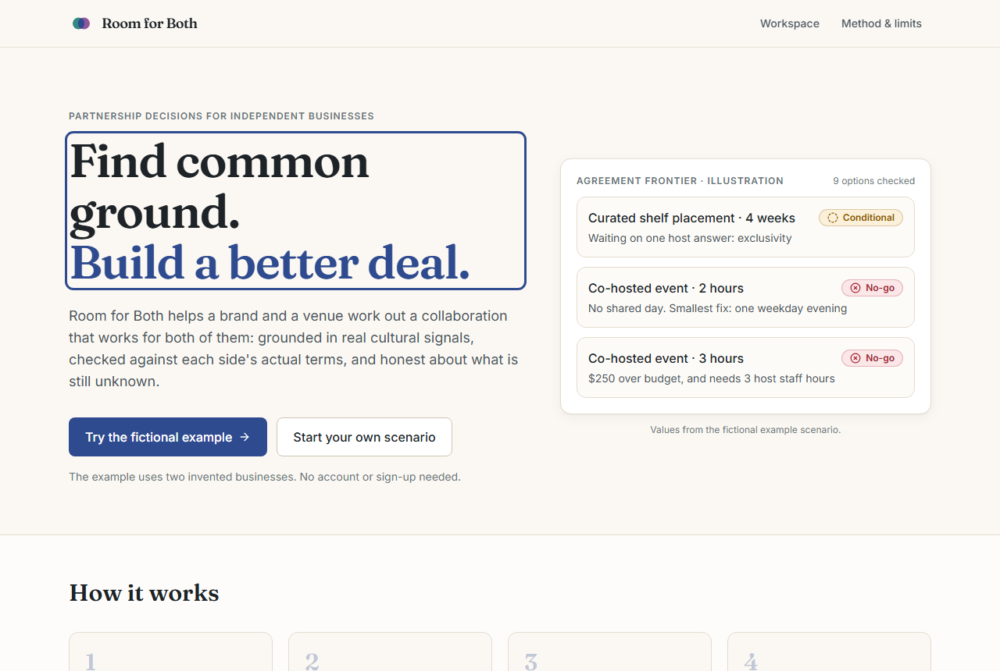
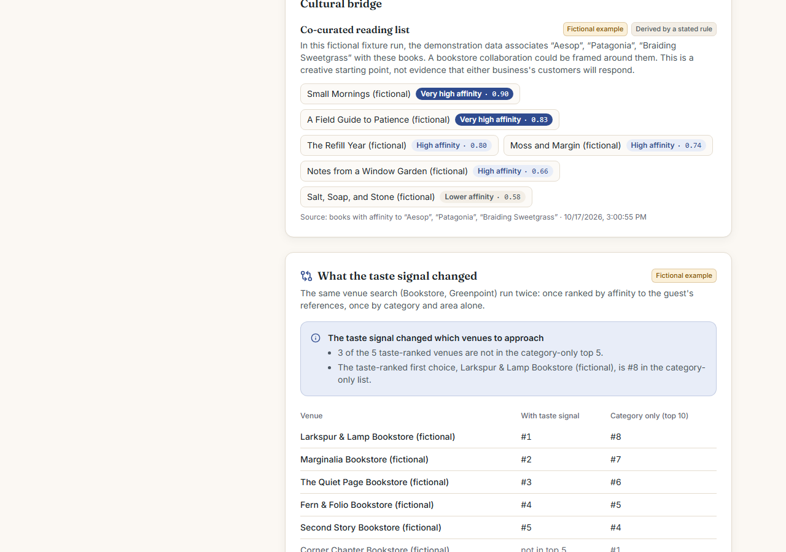
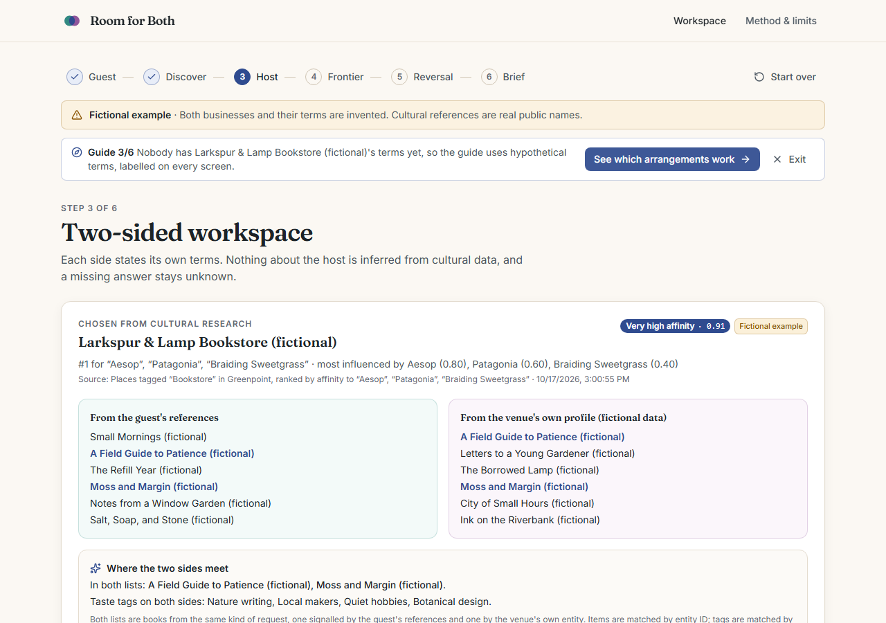
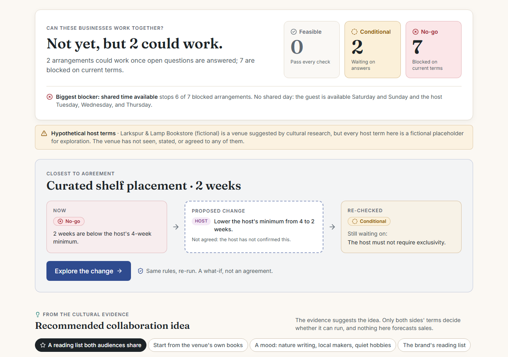
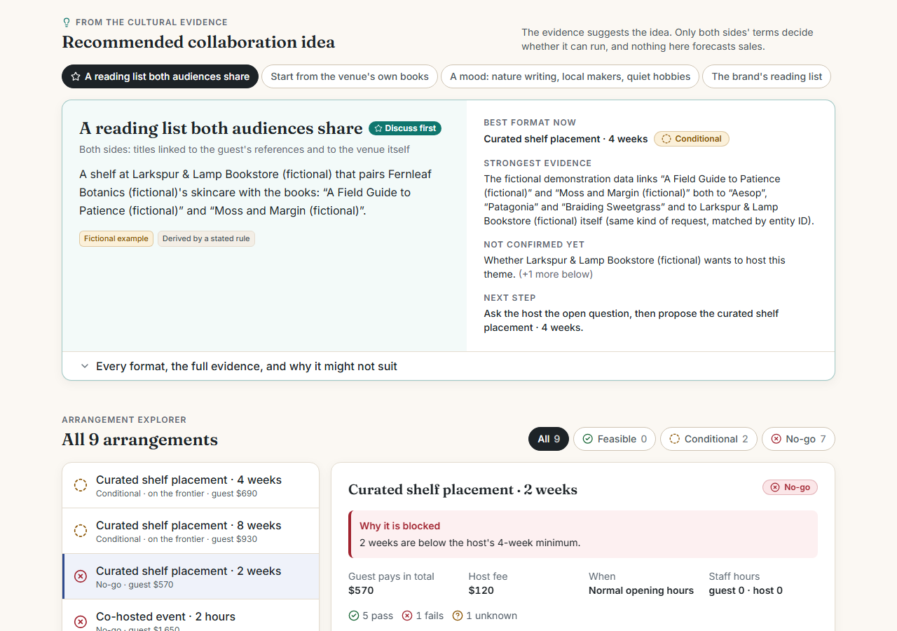
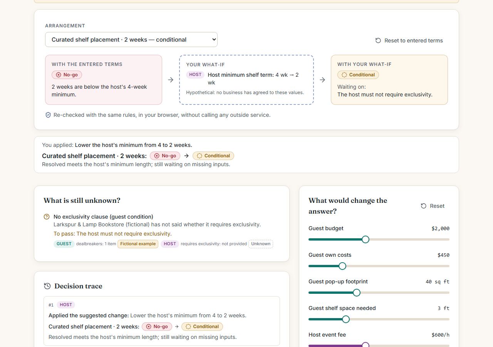
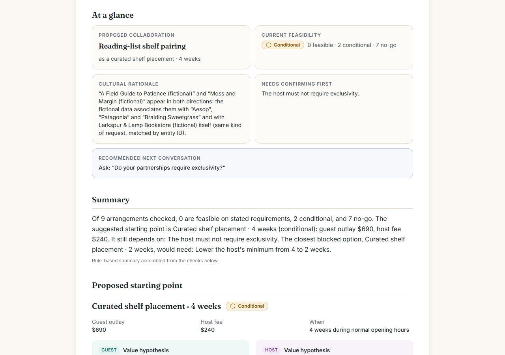

# Room for Both

**Find common ground. Build a better deal.**

Room for Both helps a small brand and an independent venue work out a collaboration that works for both of them:
which venue is worth approaching, what to propose, why the obvious arrangement might not work, and the smallest
change that would make it work.

**Live app:** https://room-for-both.room-for-both.workers.dev

Live cultural discovery currently runs on a time-limited Qloo developer credential. When it ends, the app switches
to a clearly labelled fictional demonstration ([data sources and licensing](docs/data-licensing.md)).



## Why I built it

Small partnerships between a brand and a venue (a skincare maker and a bookstore, a ceramics studio and a café)
usually stall on details rather than on interest. The brand wants a weekend; the venue only does weeknights. The
fee fits, but the brand's own costs push it over budget. Nobody knows what to propose instead, and the thread goes
quiet.

Recommendation tools tend to stop at "these places match your audience", and booking tools start once a deal
exists. I built Room for Both for the part in between, where two businesses with different terms try to find an
arrangement both can accept.

## What it does

1. **Finds venues worth approaching.** The brand gives two or three cultural references its customers identify
   with. Qloo ranks venues in the brand's area by how strongly their audiences share those tastes, explains which
   reference drove each result, and suggests a theme such as a co-curated reading list.
2. **Shows what the cultural signal actually changed.** The same venue search runs again with no references, so
   the brand sees which venues the taste signal added, moved, or left alone. An optional check repeats the search
   without each reference in turn, to show whether the first choice rests on one reference or several.
3. **Looks at the venue's side too.** The chosen venue's own Qloo profile becomes a second signal, so the guest's
   side and the venue's side are shown separately, with the titles and taste tags they share.
4. **Collects both parties' terms.** The venue states its own fees, days, space, staff time, and house rules,
   privately through an expiring link if it wants. Nothing about the venue is inferred; a missing answer stays
   unknown.
5. **Checks every arrangement.** Nine variations of a pop-up, a shelf placement, and a co-hosted event are checked
   against both sides' terms and marked *feasible on stated requirements*, *conditional*, or *no-go*, each with the
   exact checks behind it.
6. **Suggests ideas worth proposing.** Each idea comes from a different slice of the evidence (titles both sides
   share, the venue's own side, the brand's side, taste tags, the venue's stated interests) and is shown beside
   the rules engine's answer for the formats it suits, what the venue would need to confirm, and why it might not
   suit.
7. **Turns a no into "this would work if…".** Decision Reversal shows why an option is blocked and the smallest
   negotiable change that would unblock it, verified by re-running the same rules. Sliders recompute everything
   instantly.
8. **Produces a brief both sides can read.** A printable and JSON brief with the proposed starting point, each
   side's value hypothesis, the cultural evidence with sources, the first questions to ask, and, when built from
   what-if values, each proposed change marked as needing the other party's confirmation.

<p>
  
  
</p>
<p>
  
  
</p>
<p>
  
  
</p>

*Screenshots show the guided example in fixture mode: every business, venue, and cultural result in them is
fictional and labelled so.*

## What makes the approach different

- **Two parties, not one.** The venue is modelled as a party with its own terms, priorities, and non-negotiables.
  I never infer a venue's fees or willingness from cultural data, so an option that depends on an unanswered
  question stays conditional.
- **Three questions kept apart.** Cultural opportunity (what might be worth trying) comes from Qloo. Operational
  feasibility (what the stated terms permit) comes from deterministic rules. Commercial success is unknown until
  someone tries it, and the app says so instead of forecasting revenue or foot traffic.
- **The counterfactual is in the product.** Rather than asserting that taste data helps, the app shows the same
  search without it, and shows when it changed nothing.
- **Every value says where it came from:** observed in Qloo, supplied by a party, fictional example, derived by a
  rule, drafted by a language model, or unknown. Generated text can never upgrade a value's provenance.

## How Qloo and Gemini contribute

**Qloo** supplies the cultural layer: matching references to Qloo entities, ranking venues by affinity with
per-reference explanations, the cross-domain bridge (books, music, or podcasts linked to the references), taste
tags, the venue's own associations, the category-only comparison, and the leave-one-out sensitivity check. Qloo
describes aggregate taste associations. It does not observe any particular business's customers, and the app never
treats affinity as evidence of demand, space, rent, or permission.

In the live evaluation, the taste signal changed the venue list in all four scenarios with a matched reference:
one to four of five venues were swapped in three of them, and the same five were reordered in the fourth. The
venue's own side met the guest's side through shared taste tags rather than identical titles
([evaluation](docs/evaluation.md)).

**Gemini** is optional and used only after the visitor consents: a plain-language version of the rule-based
summary, a bounded research planner that may choose among two allow-listed research steps (validated before it
runs, with the rules as fallback), and a language-model-only baseline shown beside the Qloo results. A model never
decides feasibility, fees, or schedules.

## Architecture

One Cloudflare Worker serves the React app and a Hono API on the Workers Free plan, with a D1 database for private
host links and rate-limit counters. The decision engine in `src/shared/domain` is plain TypeScript that runs in
both the browser and the Worker, so what-if edits are instant and give the same answer as the server.

```text
src/shared   Zod schemas, vocabularies, deterministic engine, fictional example
src/worker   Hono API, Qloo and Gemini adapters, research planner, D1 persistence, security, telemetry
src/client   React + Vite + Tailwind single-page app
db           D1 migrations
tests        unit, integration, end-to-end, evaluation, synthetic fixtures
docs         product and engineering documentation
```

More detail: [architecture](docs/architecture.md), [decision method](docs/decision-method.md),
[API and Qloo routes](docs/api.md).

## Run it locally

Requires Node.js 22 or later.

```bash
npm ci
cp .dev.vars.example .dev.vars
npm run db:migrate:local
npm run dev
```

Without a Qloo credential the app runs in **fixture mode** with fictional cultural data, so every feature works
offline. `npm run dev:fixture` forces fixture mode even when `.dev.vars` holds credentials.

For live research, put `QLOO_API_KEY` and `QLOO_BASE_URL` (the host named in your credential's instructions) in
`.dev.vars` and run `npm run smoke:live`. For the optional model features, add `GEMINI_API_KEY` and `GEMINI_MODEL`,
then run `npm run smoke:gemini` and `npm run smoke:planner`. Keys stay server-side.

On the home page, **See it in 90 seconds** runs the guided example, **Try the fictional example** opens it with
every form, and **Start your own scenario** starts blank.

## Tests and evaluation

| Command | What it runs |
|---------|--------------|
| `npm run check` | Everything offline, as CI runs it: types, lint, unit, integration, evaluation, build |
| `npm test` | Unit tests for every constraint, frontier rule, reversal property, idea, sensitivity finding, and schema bound |
| `npm run test:integration` | The real API against a local D1, with a synthetic Qloo upstream shaped like real responses |
| `npm run test:e2e` | Playwright journeys on desktop and mobile against the production build, including widths from 320 px and axe accessibility checks |
| `npm run eval` | Offline evaluation suite; results in [evaluation-results.md](docs/evaluation-results.md) |
| `npm run eval -- --live` | Fixed live Qloo scenarios with the comparison, venue side, and sensitivity check (aggregate metrics only) |
| `npm run scan:secrets` | Tracked-file scan for secrets and private files |

What is and is not measured, including live results and Worker CPU, is in [evaluation](docs/evaluation.md).

## Privacy, security, and limits

- Workspaces stay in the visitor's browser. The server keeps only host-link records (hashed tokens, seven-day
  expiry) and counters. Details: [privacy](docs/privacy.md), [security](docs/security.md).
- Public research is bounded per visitor, per run, and per day, and fails closed if the counters are unavailable.
- Live cultural data depends on Qloo's coverage; large venues and chains can rank highly, and small independent
  venues may be missing. The app shows addresses and says when it widened a search.
- "Feasible" means feasible on the stated requirements, never an agreement. Insurance, payment terms, restocking,
  and contracts are outside the model and stay as questions. Full list: [limitations](docs/limitations.md).
- No interviews or pilots have been run yet, so every value statement is a hypothesis
  ([business case](docs/business-case.md)).

## Future directions

- Talk to brands, venues, and partnership organisers to test whether the brief shortens the path to a first
  meeting.
- A counterproposal round trip through the private host link, so the venue can accept or adjust a proposed change
  itself.
- More arrangement types (consignment, revenue share, residencies) and specific dates instead of weekly windows.

## Documentation

[Business case](docs/business-case.md) · [Decision method](docs/decision-method.md) ·
[Architecture](docs/architecture.md) · [API](docs/api.md) · [Data sources and licensing](docs/data-licensing.md) ·
[Security](docs/security.md) · [Privacy](docs/privacy.md) · [Limitations](docs/limitations.md) ·
[Evaluation](docs/evaluation.md) · [Deployment and rollback](docs/deployment.md)

## Data and attribution

Cultural data, when live, comes from the [Qloo Insights API](https://docs.qloo.com/) and is shown with its source
and limits. It is used under Qloo's terms for the current credential, is not stored beyond what
[data sources and licensing](docs/data-licensing.md) lists, and is never included in this repository. Optional
summaries, planner decisions, and the language-model baseline use Google's Gemini API, each only after visitor
consent. Fonts are Inter and Fraunces (SIL Open Font License) via Fontsource. Icons are from Lucide (ISC).

## Licence

[MIT](LICENSE)
