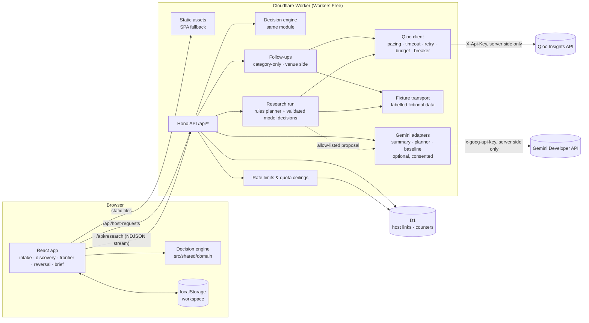

# Architecture

Room for Both is one Cloudflare Worker that serves a React single-page app as static assets and a small
Hono API under `/api/*`. The decision engine is plain TypeScript shared by the browser and the Worker.

## Request flows

**What-if editing (no network).** Every keystroke or slider move in the workspace re-runs
`evaluateScenario` in the browser. The engine enumerates nine arrangement options, checks every hard
constraint, computes the Agreement Frontier, verified minimal changes, and ranked questions in well under
a millisecond (see `docs/evaluation-results.md`). No Qloo quota is spent.

**Cultural research (streamed).** `POST /api/research` validates the request, checks a per-client hourly
limit and the daily upstream ceiling in D1, then streams newline-delimited JSON events: the plan, one event
per completed step, and the final run (or an error). The planner makes at most `QLOO_MAX_CALLS_PER_RUN`
calls (default 7), which keeps each request well inside the Workers Free limit of 50 subrequests.

**Planner decisions.** Each run has two decision points: after references are matched (which cultural domain to
build the bridge from, whether to ask the visitor to confirm an approximate reference, or, with nothing matched,
whether to stop) and after an empty neighbourhood search (widen to the city or stop). The rules decide by default.
If the visitor asked for the model planner and consented, one Gemini call per decision point (at most
`PLANNER_MAX_DECISIONS`, default 2) proposes one action through a response schema. The Worker validates it
against the allow-list and the run's own state; anything else, or any timeout, quota, or format failure, runs the
rule's choice. Each decision is streamed as a `decision` event and kept in the run's `planner` trace. There is no
loop and no model-chosen URL, endpoint, or parameter.

**Follow-ups (one upstream call each).** `POST /api/research/baseline` repeats the run's venue search with no taste
signal, deeper (10 venues) so taste-ranked venues can be located in it. `POST /api/research/venue-bridge` uses the
chosen venue's own entity as the signal in the bridge's domain. Each is its own request with its own budget, the
same limiter family, and the same daily ceiling, and accepts only identifiers matching strict patterns and the
run's mode.

**Venue selection.** Choosing a venue freezes it in the browser with the run ID, signals, guest-side bridge, and,
when fetched, the venue side and the comparison. A later research run never changes that snapshot; the brief cites
the run the venue came from. A selection describes the brief only while the host record still carries that
venue's entity ID.

**Host response link.** The guest creates a link (`POST /api/host-requests`). The server stores a SHA-256
hash of a 256-bit host token and of a separate owner token, the summary the guest chose to share, and an
expiry. The host opens `/respond#t=<token>`; the token stays in the URL fragment (never sent in requests or
Referer headers) and is forwarded only as a bearer header. The server sets the answer's provenance.

## Trust boundaries

| Boundary | Controls |
|----------|----------|
| Browser → Worker | Zod strict schemas on every body, 32 KB body limit, JSON content type required, cross-origin writes refused, no cookies, bearer tokens for private routes |
| Worker → Qloo | Key only in Worker secrets; base URL must be `https` on a `qloo.com` host; calls paced below the per-second limit; per-call timeout; at most one retry on 429/5xx/timeouts (a 429 waits for the reported reset; an exhausted monthly allowance is not retried); per-run call budget; daily ceiling; per-isolate circuit breaker; response size cap; every payload re-validated field by field |
| Worker → Gemini | Disabled unless configured; visitor consent required per request; structured facts only (no free prompt field from the browser); response schemas; summaries checked for added numbers, links, and claims; planner proposals validated against an allow-list and the run's state; baseline suggestions with links, markup, or outcome claims discarded; one shared daily allowance |
| Worker → D1 | Parameterised statements only; no raw IPs, budgets, or plaintext tokens stored; daily cleanup by cron |
| Static assets | `_headers` sets CSP (`default-src 'self'`), `X-Frame-Options: DENY`, `nosniff`, referrer and permissions policies; no source maps shipped |

## Design choices

See `.agent/DECISIONS.md` for the full records. In short:

- **One Worker, same origin.** No CORS, one deploy, fits Workers Free.
- **Engine in `src/shared`.** Reproducible decisions everywhere, instant what-if edits.
- **Streaming research.** Truthful step-by-step progress without polling or fake percentages.
- **Fixture mode as a first-class, labelled mode.** The full product works offline and in CI without credentials,
  and every fictional value says so.
- **D1 only where state must be shared.** Workspaces stay in the visitor's browser.

## Fallbacks

| Failure | Behaviour |
|---------|-----------|
| No Qloo credential | Labelled fixture mode; banner on discovery; brief marks cultural evidence as fictional |
| Qloo credential rejected (expired, revoked, wrong host) | "Live Qloo access is not authorized right now"; the visitor can run the labelled fictional demonstration or continue without cultural evidence |
| Qloo rate limit, monthly allowance used up, timeout, or outage | "Live cultural data is temporarily unavailable", with retry where useful, the fictional demonstration, or continuing without cultural evidence |
| Cross-domain lookup rejected or empty | The bridge falls back to taste tags scoped to the references' own entity types, and says so |
| Reference or category not matched exactly | Disclosed, not used as a signal; venue search skipped rather than guessed |
| No venues in a neighbourhood | Search widens to the city once, then reports none |
| Per-run call budget reached | Remaining steps are skipped; results found so far are kept and marked partial |
| D1 unavailable | Live research fails closed (cannot bound spend); evaluation and fixture research still work |
| Gemini absent or output rejected | Rule-based summary is always shown |
| Model planner unavailable, not consented, over its allowance, slow, or answering outside the allow-list | The rule's decision runs; the trace says why |
| Category-only comparison or venue-side lookup fails | The taste-informed results and the brief are unaffected; the panel says the lookup is unavailable |
| A category with no cross-domain type (for example a plant shop) | No venue-side lookup; the venue's own stated programming interests shape the activation idea instead |
