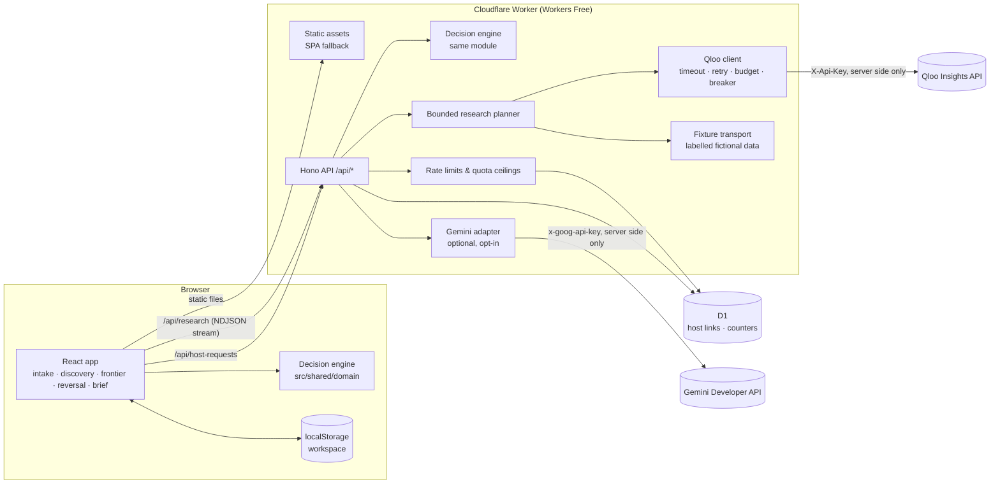

# Architecture

Room for Both is one Cloudflare Worker that serves a React single-page app as static assets and a small
Hono API under `/api/*`. The decision engine is plain TypeScript shared by the browser and the Worker.

## Request flows

**What-if editing (no network).** Every keystroke or slider move in the workspace re-runs
`evaluateScenario` in the browser. The engine enumerates nine arrangement options, checks every hard
constraint, computes the Agreement Frontier, verified minimal changes, and ranked questions in well under
a millisecond (see `docs/evaluation-results.md`). No Qloo quota is spent.

**Cultural research (streamed).** `POST /api/research` validates the request, checks a per-client hourly
limit and the daily upstream ceiling in D1, then streams newline-delimited JSON events: the plan, one event
per completed step, and the final run (or an error). The planner makes at most `QLOO_MAX_CALLS_PER_RUN`
calls (default 7), which keeps each request well inside the Workers Free limit of 50 subrequests.

**Host response link.** The guest creates a link (`POST /api/host-requests`). The server stores a SHA-256
hash of a 256-bit host token and of a separate owner token, the summary the guest chose to share, and an
expiry. The host opens `/respond#t=<token>`; the token stays in the URL fragment (never sent in requests or
Referer headers) and is forwarded only as a bearer header. The server sets the answer's provenance.

## Trust boundaries

| Boundary | Controls |
|----------|----------|
| Browser → Worker | Zod strict schemas on every body, 32 KB body limit, JSON content type required, cross-origin writes refused, no cookies, bearer tokens for private routes |
| Worker → Qloo | Key only in Worker secrets; base URL must be `https` on a `qloo.com` host; per-call timeout; at most one retry on 429/5xx/timeouts; per-run call budget; per-isolate circuit breaker; response size cap; every payload re-validated |
| Worker → Gemini | Disabled unless configured; visitor consent required per request; structured facts only (no prompt field); output schema, number, link, and claim checks |
| Worker → D1 | Parameterised statements only; no raw IPs, budgets, or plaintext tokens stored; daily cleanup by cron |
| Static assets | `_headers` sets CSP (`default-src 'self'`), `X-Frame-Options: DENY`, `nosniff`, referrer and permissions policies; no source maps shipped |

## Design choices

See `.agent/DECISIONS.md` for the full records. In short:

- **One Worker, same origin.** No CORS, one deploy, fits Workers Free.
- **Engine in `src/shared`.** Reproducible decisions everywhere, instant what-if edits.
- **Streaming research.** Truthful step-by-step progress without polling or fake percentages.
- **Fixture mode as a first-class, labelled mode.** The full product works offline and in CI without credentials,
  and every fictional value says so.
- **D1 only where state must be shared.** Workspaces stay in the visitor's browser.

## Fallbacks

| Failure | Behaviour |
|---------|-----------|
| No Qloo credential | Labelled fixture mode; banner on discovery; brief marks cultural evidence as fictional |
| Qloo rate limit, auth error, or outage | Research stops with a plain-language error; "Continue without cultural evidence" keeps the decision tools usable |
| Reference or category not matched exactly | Disclosed, not used as a signal; venue search skipped rather than guessed |
| No venues in a neighbourhood | Search widens to the city once, then reports none |
| Per-run call budget reached | Remaining steps are skipped; results found so far are kept and marked partial |
| D1 unavailable | Live research fails closed (cannot bound spend); evaluation and fixture research still work |
| Gemini absent or output rejected | Rule-based summary is always shown |
